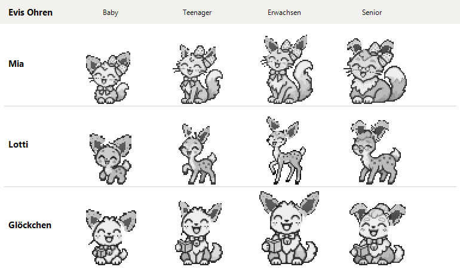

# Grillme: Genetik, Schritte 1–5

Stand 26. November 2026. Im lokalen Repo lässt sich [index.html](index.html) direkt im Browser öffnen. Oben erscheint die Kreuzung, darunter stehen die beiden Graustufen-Originale zum Vergleich. Die Vorschau zeigt Evis Ohren auf Mia, Lotti und Glöckchen in allen vier Altersstufen. „Andere Kreuzung zeigen“ wechselt zur nächsten zufällig gewählten Grundform aus diesen drei Varianten.

## Beschlossene Anforderungen

- Genetische Basis: 21 bestehende Tamagotchis, davon Evi plus 20 Parkfiguren. Kind und erwachsenes Tier haben eine individuell zusammengesetzte Gestalt. Dieselbe Kombination soll sichtbar durch Baby, Teenager, Erwachsen und Senior altern.
- Kopf, Hals, Körper und Beine bleiben eine zusammenhängende Grundform. Fellzeichnung und schwierige anatomische Merkmale gehören ebenfalls dazu. Ohren, Augen, Schnauze und Schwanz sind grundsätzlich separat vererbbar. Flügel, Hörner und Geweih nur, wenn die Grundform sie aufnehmen kann.
- Ausschließlich direkte, sichtbare Vererbung aus den Eltern; keine Mutation, keine rezessiven Gene. Bei der Auswahl nach Möglichkeit eine Kombination wählen, die sich von beiden Eltern unterscheidet. Ist dies wegen kompatibler Teile nicht möglich, geht anatomische Stimmigkeit vor.
- Jede Grundform legt erlaubte Teilarten und Ankerpunkte pro Altersstufe fest. Unpassende Teile werden ausgeschlossen. Ungewöhnliche, aber gut sitzende Kombinationen bleiben erlaubt.
- Eine gemeinsame Animationslogik soll später für alle Kombinationen Laufen, Schlafen und weitere Posen tragen. Vor einer Integration müssen diese Posen und Speicherbedarf separat geprüft werden (Schritt 6).
- Bei jedem Generationswechsel wird die Dorfbevölkerung neu zusammengesetzt: Nachkommen bisheriger Bewohner und neue Kreuzungen der 21 Ausgangsfiguren. Ohne Partner bleibt das bisherige Tamagotchi ein genetischer Elternteil; der zweite wird aus der Bibliothek zufällig zusammengestellt.
- Stammbaum: individuelles Porträt aus gespeicherten Merkmals-IDs und Name. Bestehende Stammdaten bleiben erhalten. Keine detaillierte Auflistung, welcher Elternteil welches Teil gab. Die derzeitige Firmware speichert nur acht Verstorbene, während früher einmal 50 diskutiert wurden; eine spätere Speicherentscheidung ist nötig.
- Zehn Persönlichkeitstypen, zufällig einer je Tamagotchi. Sie beeinflussen Verhalten, Bedürfnisse und Vorteile spürbar. Enthüllung beim Erwachsenwerden nach drei Lebenstagen, danach im Steckbrief und Stammbaum. Die konkreten zehn Typen und Effekte sind noch nicht beschlossen. Der aktuelle Code kennt sechs Wesen; die neue Regel ist daher eine spätere Änderung.
- Zusätzliche Bedürfnisse Energie und Geselligkeit mit eigenen Anzeigen. Pflegeverantwortung wird gemeinsam getragen. Konkrete Werte und Spielregeln sind noch offen.

## Bestandsaufnahme

| Quelle | Befund |
|---|---|
| `entwuerfe/neue-tamagotchis/graustufen/<name>/<phase>-gluecklich.png` | 20 Figuren × vier Phasen = 80 PNG. Einheitliche Leinwand 72 × 64, 16 Graustufen, binäres Alpha, Standlinie Zeile 61 laut geprüftem Exportskript `make-besucher-grau.py`. |
| `entwuerfe/evi/graustufen-vorschau/Evi-Graustufen.zip` | Vier aktuelle `Sprites/<Phase>/gluecklich.png` für Evi: Baby 94 × 89, Teenager 81 × 107, Erwachsen 114 × 116, Oma 115 × 110. Weitere Emotionen und Posen sind enthalten. Die älteren Schwarz-Weiß-Zeichnungen sind nicht die Prototypquelle. |
| `software/schritt-10/tools/make-besucher-grau.py` | Schneidet transparente Außenränder weg und packt die 80 Bilder für `besucherbilder.h`; es zerlegt keine Körperteile. |
| `software/schritt-10/tools/make-evi-grau.py` | Verknüpft Evis aktuelle Graustufen-Sprites mit bisherigen Formen; ebenfalls keine modularen Teile. |
| `software/schritt-10/` | Waveshare/Pico-2-Renderer, 320 × 240 Display, Graustufen. Zimmer und Park skalieren die Figur aus der Fußposition; Parkfiguren werden altersgleich zu Evi gezeigt. |
| `PROJEKTSTAND.md` | Spielstand im 4096-Byte-EEPROM weitgehend belegt, etwa 330 Byte Lücken. Flash und RAM müssen vor einer Integration gemessen werden. |

Die 84 Bilder zeigen die Altersstufen in einer glücklichen Pose. Die Merkmale sind Teil der flachen Zeichnungen. Für die Ohrvorschau wurden eigene Freistellkonturen in den Originalen markiert. Gesicht, Schwanz und weitere Posen brauchen eigene Konturen und Ansatzpunkte.

## Modularer Vertrag

Koordinaten beziehen sich auf eine 72 × 64 Entwurfsfläche mit Fußlinie `y=61`. Evis aktuelle Graustufen-Vorlage wird proportional eingepasst, die drei Parkfiguren liegen schon in diesem Raster. Die Masken arbeiten auf ganzen Pixeln und erhalten die Zeichnung in Graustufen. Das geplante Laufzeitschema referenziert pro Figur und Alter `grundform`, `ohren`, `augen`, `schnauze`, `schwanz` sowie optional `fluegel`, `hoerner`, `geweih`.

| Anker je Altersstufe | Bedeutung | Vorschauwert/Herleitung |
|---|---|---|
| `fuss` | Skalierung und Platzierung | `(36,61)`; Evi-Sprite an Fußlinie eingepasst |
| `ohr_links`, `ohr_rechts` | Ansatz am Kopf | Je eine handgesetzte Kontur und ein Ansatzpunkt pro Ohr, Figur und Alter in [ohren.js](ohren.js) |
| `augen`, `schnauze` | Gesichtsmitte und Überdeckung | In der aktuellen Vorschau Teil der Grundform |
| `schwanz` | hinterer Rumpfansatz | In der aktuellen Vorschau Teil der Grundform |
| `fluegel`, `hoerner`, `geweih` | optionale Ansatzpunkte | in diesen vier Quellen nicht vorhanden; erst mit geeigneten Basisfiguren kalibrieren |

Ein Ohrtausch entfernt zuerst die Originalohren aus der Grundform. Dann richtet [vorschau.js](vorschau.js) die beiden freigestellten Ohren am linken und rechten Kopfansatz aus. Die Grundform wird davor gezeichnet und deckt den Ansatz ab. So bleibt auch Mias Schleife sichtbar. Gemeinsame Bewegungszustände sollen später Anker und Teile zusammen transformieren.

## Kompatibilität und Vorschautest

Die Auswahl lässt die Originale und die drei gerichteten Ohrübertragungen von Evi zu Mia, Lotti und Glöckchen zu. Jede erlaubte Übertragung hat für alle vier Lebensphasen eigene Platzierungswerte. Für weitere Figuren müssen Körperklassen wie vierbeinig, sitzend/aufrecht, Schnecke (Mimi) und schwebend (Spuki) berücksichtigt werden. Die Übertragung setzt einen gültigen Anker und eine geprüfte Überdeckung voraus. Wo ein passender Tausch fehlt, bleibt das Teil der Grundform sichtbar.

In Edge wurden die zwölf Kreuzungsbilder am Original und auf lose Pixel geprüft. Laufen, Schlafen und die getrennte Vererbung von Augen, Schnauze und Schwanz stehen noch aus. Die Übernahme weiterer Figuren hängt von der optischen Freigabe ab.
