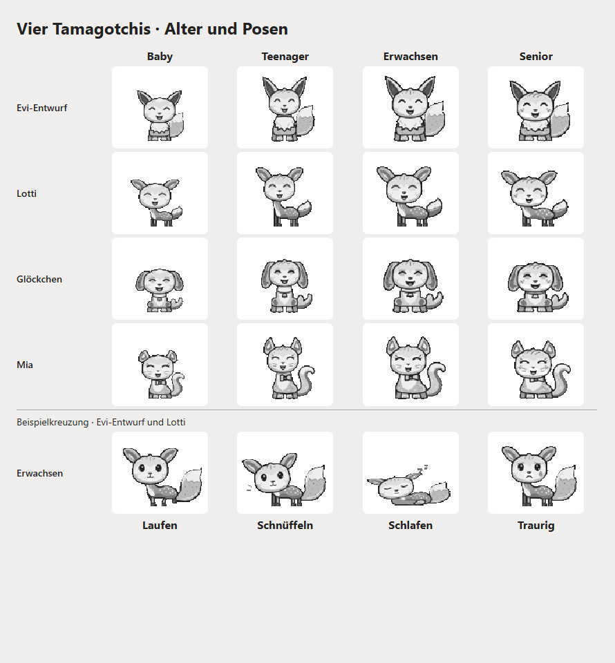

# Vier Graustufen-Tamagotchis in allen Altersstufen

[index.html](index.html) lässt sich aus dem lokalen Repo direkt im Browser öffnen. Wähle zwei Eltern und die Herkunft der fünf Merkmale. Die Regler für Emotion und Pose gelten für Eltern und Kind in allen vier Altersstufen. Bewegte Posen lassen sich über „Animation abspielen“ anhalten.

## Figuren

- **Evi-Entwurf** mit spitzen Ohren, heller Halskrause und buschigem Schwanz mit heller Spitze. Vorbild sind Evis aktuelle Graustufensprites.
- **Lotti** mit breiten Rehohren, langen Beinen, heller Kehle, Flecken und kurzem Schwanz.
- **Glöckchen** mit Schlappohren, Glöckchen am Hals, breiten Pfoten und kleinem gebogenem Schwanz.
- **Mia** mit Katzenohren, Schnurrhaaren, Schleife, hellem Brustfell und langem gebogenem Schwanz.

Die Zeichnungen für den Prototyp sind neue Module nach den früheren Entwürfen. Die runde Kopfkontur ist pro Altersstufe bei allen Figuren gleich. Ohren, Augen, Mundpartie, Körper und Schwanz bleiben einzeln vererbbar. Fellzeichnung und Zubehör wie die Schleife sind Teil des Körpers. Der Schwanz setzt für jede Grundform am passenden Punkt an.

Das Alter verändert die Proportionen, den Fellstrich, die Ohrhöhe und die Haltung. Die Babys sind kompakt, Teenager schmaler und langbeiniger, Erwachsene kräftiger. Senioren haben hellere Wangen, Fältchen und eine tiefere Haltung. Die Vorschau zeichnet in einem 112 × 96 Raster aus 16 neutralen Graustufen mit ganzen transparenten Pixeln. Das größere Raster bietet Platz für Fellzeichnung und Bewegung.

## Emotionen und Posen

| Auswahl | Inhalt |
|---|---|
| Emotionen | Neutral, glücklich, hungrig, traurig, müde, krank, schmutzig, beleidigt |
| Bewegung | Laufen, schnüffeln, schlafen, untersuchen, singen, gähnen, drehen, hüpfen |
| Feste Posen | Ruhepose, Fund zeigen, aus dem Fenster schauen, denken, staunen |

Schlafen und Gähnen schließen die Augen. Singen und Gähnen öffnen die Mundpartie. Beim Drehen erscheint zwischendurch die Rückseite. Solche Posen haben Vorrang vor dem entsprechenden Gesichtsausdruck. Die übrigen Merkmale bleiben von der Kreuzung bestimmt.

Der Browsertest prüfte die Auswahlfelder, alle sechs Elternpaare in der Ruhepose und die Formen von Körper, Ohren und Schwanz in ausgewählten Einzelbildern jeder Pose. Dabei wurden Bildränder, die Graustufenpalette und sichtbare Lücken zwischen den Teilen geprüft.

Die Vorschau ist ein eigenständiger Entwurf für die optische Prüfung. Die Originalzeichnungen, Firmware und Spielstände sind von ihr unabhängig.
