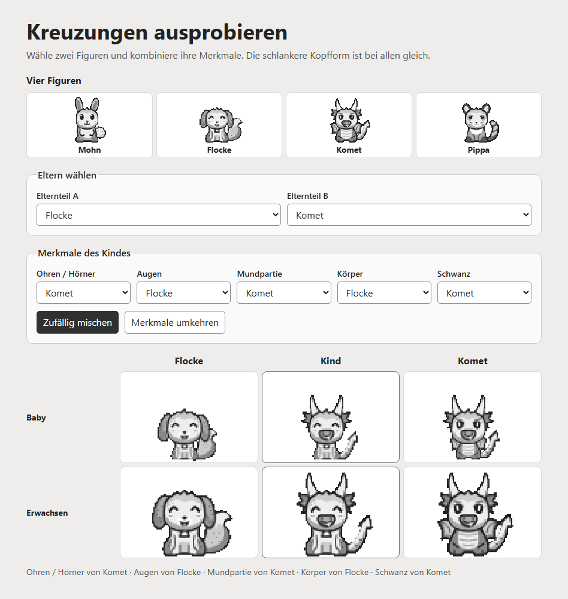

# Vier Tamagotchis mit gemeinsamer Kopfform

[Die Vorschau](index.html) lässt sich aus dem lokalen Repo direkt im Browser öffnen. Oben stehen alle vier Figuren zur Ansicht. Darunter wählt man zwei Eltern und stellt für jedes der fünf Merkmale ein, von wem es kommt. Die Auswahl gilt für beide gezeigten Altersstufen.

- **Mohn** hat Stehohren, offene Augen, einen aufrechten Sitz und einen Stummelschwanz.
- **Flocke** hat Schlappohren, lächelnde Augen, einen gerade sitzenden Hundekörper mit Glöckchen und einen buschigen Schwanz.
- **Komet** ist ein kleiner Drache mit Hörnern, gezackten Ohren, Flügeln und einer Pfeilspitze am Schwanz. Die Flügel gehören zum Körper.
- **Pippa** ist eine Waldkatze mit dunklen Ohren, Schnurrhaaren, hellem Brustfell und einem geringelten Schwanz.

Die gemeinsame Kopfform ist schmaler als im ersten Entwurf und bleibt pro Altersstufe bei allen Kombinationen gleich. Ohren und Hörner belegen denselben Platz in der Auswahl. Augen und Mundpartie haben getrennte Zeichenebenen, und jeder Körper bringt seinen eigenen Schwanzansatz mit. Die Motive verwenden wie die Parkfiguren ein 72 × 64 Raster mit 16 möglichen Graustufen.

In Edge wurden alle sechs Elternpaare mit je 32 Merkmalswahlen als Baby und erwachsen geprüft. Der Test prüfte die Auswahl, den Elternvergleich, die Graustufen und zusammenhängende Silhouetten. Teenager, Senior und die Animationen stehen noch aus.
