# Neue Tamagotchis – Vorschläge (21. November 2026)

20 Ideen für Partner von Evi und für spätere eigene Tamagotchis: 10 männliche, 10 weibliche.
Jedes ist ein **eigenes Wesen** mit einer deutlichen Anspielung auf einen bekannten Spieleklassiker oder Disney-Film, keine genaue Kopie der Originalfigur
(so wie Evi ein eigener Entwurf im Evoli-Stil ist).

Das „Wesen“ ist ein Vorschlag für eine Persönlichkeit, die sich später im Spiel auswirken könnte. Noch nichts davon ist beschlossen.

Unter jedem Vorschlag steht eine Zeichnung der erwachsenen, glücklichen Figur im Schwarz-Weiß-Pixelstil von Evi. Die einzelnen PNGs liegen neben dieser Datei.

## So entstehen die Bilder

Claude kann keine Bilder erzeugen. Evis Bilder kamen aus dem Bildgenerator von ChatGPT, deshalb steht unten
für jede Figur ein fertiger Auftrag für das Bild „glücklich“.

1. In ChatGPT ein neues Bild anfordern und **Evis Bild als Stilvorlage anhängen:**
   `entwuerfe/evi/emotionen/erwachsen/evi-erwachsen-gluecklich.png`
   Dann sehen die neuen Figuren aus wie aus derselben Familie (gleiche Pixel, gleiche Punkte, gleiche Größe).
2. Den Auftrag der Figur einfügen (der ganze Text im grauen Kasten).
3. Gefällt das Bild, hier ablegen als `name-gluecklich.png`, zum Beispiel `funke-gluecklich.png`.

Die Aufträge nennen die Originalfiguren absichtlich nicht beim Namen. Wiedererkennbar sind sie an ihren typischen Merkmalen
(Haarbüschel, Riesenohren, Tupfen …). Nach dem Original zu fragen, lehnt der Bildgenerator oft ab.

## Übersicht

| | Name | Tier | Anspielung | Wesen |
|---|---|---|---|---|
| ♂ | Funke | Elektro-Eichhörnchen | Pokémon (Elektro-Tiere wie Pikachu) | aufgedreht, verspielt |
| ♂ | Rolli | Igel | Sonic | flink, ungeduldig |
| ♂ | Tetro | Schildkröte | Tetris, Schiggy | ruhig, ordentlich |
| ♂ | Mampf | Hamster | Pac-Man | verfressen |
| ♂ | Linus | Hase | The Legend of Zelda | mutig, abenteuerlustig |
| ♂ | Bit | Roboterhund | Game Boy, Mega Man | neugierig, schlau |
| ♂ | Blubber | kleiner Drache | Bubble Bobble, Spyro | sanft, tollpatschig |
| ♂ | Groschen | Waschbär | Animal Crossing | sparsam, geschäftstüchtig |
| ♂ | Leo | Löwenjunges | Simba (Der König der Löwen) | selbstbewusst, angeberisch |
| ♂ | Blip | Außerirdischer | Stitch (Lilo & Stitch) | frech, chaotisch |
| ♀ | Kiwi | Dino | Yoshi | fröhlich, verfressen |
| ♀ | Mimi | Schnecke | Super-Mario-Pilz | gemütlich, ordentlich |
| ♀ | Glöckchen | Hündin | Animal Crossing | hilfsbereit |
| ♀ | Lumi | Glühwürmchen-Fee | Feen aus Zelda („Hey, hör zu!“) | neugierig, redselig |
| ♀ | Spuki | Geisterkätzchen | Pac-Man-Geister, Buu Huu | schüchtern, treu |
| ♀ | Moosi | Waldgeist | Krogs (Zelda: Breath of the Wild) | verspielt, versteckt sich gern |
| ♀ | Mia | Kätzchen | Marie (Aristocats) | vornehm, eitel |
| ♀ | Lotti | Rehkitz | Bambi | verträumt, staunend |
| ♀ | Klecksi | Dalmatinerwelpe | 101 Dalmatiner | wild, verspielt |
| ♀ | Ella | Elefantenbaby | Dumbo | lieb, etwas unsicher |

---

## Männlich

### Funke – Elektro-Eichhörnchen

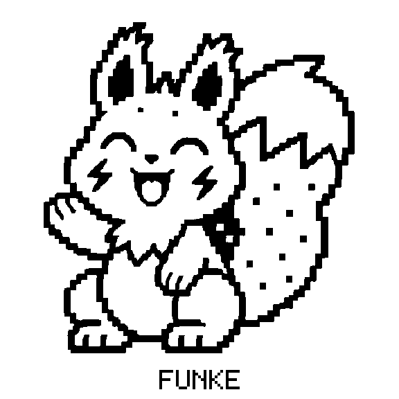

Anspielung: die Elektro-Tiere aus Pokémon. Kleine Blitze auf den Backen, buschiger Schwanz in Zickzack-Blitzform.
Wesen: aufgedreht und verspielt – Spielen macht ihn besonders glücklich, aber er wird auch schnell wieder unruhig.

```
Use case: stylized-concept. Asset type: standalone character design drawing for a black-and-white virtual pet game. The attached image shows Evi, a pet from the same game: use it ONLY as reference for drawing style, line weight, dot pattern and overall size, NOT for species or features. Original character, not a copy of any existing game or franchise character. Strict pure black and white pixel art, crisp stepped pixel outlines, sparse regular black square dot dithering only on darker fur or skin areas, clean white face; no gray, no color, no gradients, no smooth vector lines, no 3D. White background, one large centered full-body character with generous white margins, no room, no UI, no watermark, no border, no props unless described. Expression: VERY HAPPY, matching the reference: joyful closed upward-curving crescent eyes, wide cute open smile, two tiny paired pixel cheek marks. One small discreet black pixel-font caption directly below the feet, no other text.
Character: FUNKE, a small male electric squirrel. Round head, short pointed ears with little tufted tips, a tiny lightning-bolt mark on each round cheek, white belly, dotted fur on head, back and tail. A large bushy tail shaped like a zigzag lightning bolt with a white tip, curling up on the viewer's right. Energetic seated pose with one tiny paw raised in a wave.
Caption verbatim: "FUNKE".
```

### Rolli – Igel

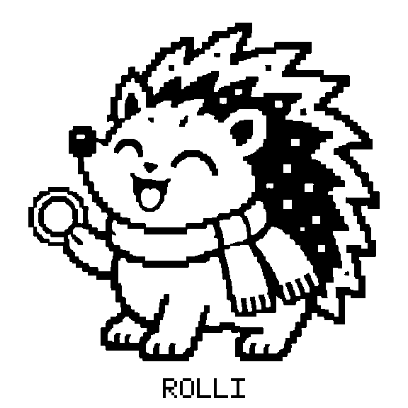

Anspielung: Sonic. Nach hinten gekämmte Stacheln, ein kleiner flatternder Schal, als wäre er gerade angehalten, und ein Ring in der Pfote.
Wesen: flink und ungeduldig – liebt Ballfangen, mag nicht lange warten.

```
Use case: stylized-concept. Asset type: standalone character design drawing for a black-and-white virtual pet game. The attached image shows Evi, a pet from the same game: use it ONLY as reference for drawing style, line weight, dot pattern and overall size, NOT for species or features. Original character, not a copy of any existing game or franchise character. Strict pure black and white pixel art, crisp stepped pixel outlines, sparse regular black square dot dithering only on darker fur or skin areas, clean white face; no gray, no color, no gradients, no smooth vector lines, no 3D. White background, one large centered full-body character with generous white margins, no room, no UI, no watermark, no border, no props unless described. Expression: VERY HAPPY, matching the reference: joyful closed upward-curving crescent eyes, wide cute open smile, two tiny paired pixel cheek marks. One small discreet black pixel-font caption directly below the feet, no other text.
Character: ROLLI, a small male hedgehog. Round white face and white belly, short snout with a little black nose, small round ears, long swept-back spines drawn as bold outlined spikes with dotted texture. A tiny scarf whose two ends flutter behind him as if he just stopped running. He holds one small ring (a plain outlined circle) in one paw. Sporty, confident seated pose.
Caption verbatim: "ROLLI".
```

### Tetro – Schildkröte

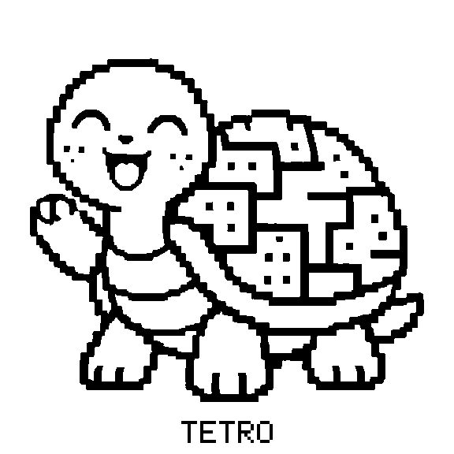

Anspielung: Tetris und Schiggy. Sein Panzer besteht aus ineinandergesteckten Tetris-Steinen.
Wesen: ruhig und ordentlich – wird langsamer schmutzig, mag Ratespiele wie „Links oder rechts?“.

```
Use case: stylized-concept. Asset type: standalone character design drawing for a black-and-white virtual pet game. The attached image shows Evi, a pet from the same game: use it ONLY as reference for drawing style, line weight, dot pattern and overall size, NOT for species or features. Original character, not a copy of any existing game or franchise character. Strict pure black and white pixel art, crisp stepped pixel outlines, sparse regular black square dot dithering only on darker fur or skin areas, clean white face; no gray, no color, no gradients, no smooth vector lines, no 3D. White background, one large centered full-body character with generous white margins, no room, no UI, no watermark, no border, no props unless described. Expression: VERY HAPPY, matching the reference: joyful closed upward-curving crescent eyes, wide cute open smile, two tiny paired pixel cheek marks. One small discreet black pixel-font caption directly below the feet, no other text.
Character: TETRO, a small male turtle sitting upright on short legs. Big round head, short stubby tail. His domed shell is made of interlocking blocky tetromino pieces (L, T, S and square shapes) with clear black outlines; alternate pieces are dot-dithered or plain white. White belly plate with a few simple horizontal lines. Calm, friendly pose.
Caption verbatim: "TETRO".
```

### Mampf – Hamster

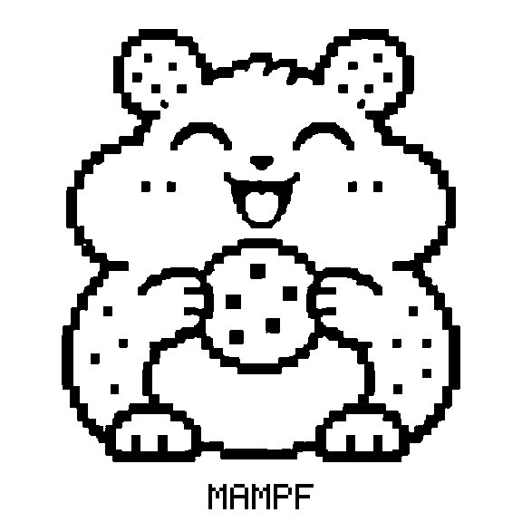

Anspielung: Pac-Man. Kugelrund, riesige Backentaschen, beim Lachen ein Maul wie ein ausgeschnittenes Tortenstück, in der Pfote ein Keks.
Wesen: verfressen – wird schneller hungrig, freut sich über Essen doppelt.

```
Use case: stylized-concept. Asset type: standalone character design drawing for a black-and-white virtual pet game. The attached image shows Evi, a pet from the same game: use it ONLY as reference for drawing style, line weight, dot pattern and overall size, NOT for species or features. Original character, not a copy of any existing game or franchise character. Strict pure black and white pixel art, crisp stepped pixel outlines, sparse regular black square dot dithering only on darker fur or skin areas, clean white face; no gray, no color, no gradients, no smooth vector lines, no 3D. White background, one large centered full-body character with generous white margins, no room, no UI, no watermark, no border, no props unless described. Expression: VERY HAPPY, matching the reference: joyful closed upward-curving crescent eyes, wide cute open smile, two tiny paired pixel cheek marks. One small discreet black pixel-font caption directly below the feet, no other text.
Character: MAMPF, a very round, chubby male hamster, almost a perfect ball. Huge stuffed cheek pouches, tiny round ears, short stubby paws holding one small round cookie. His laughing mouth is very wide and wedge-shaped, like a slice cut out of a circle. White face and belly, small dotted patches on back and ears.
Caption verbatim: "MAMPF".
```

### Linus – Hase

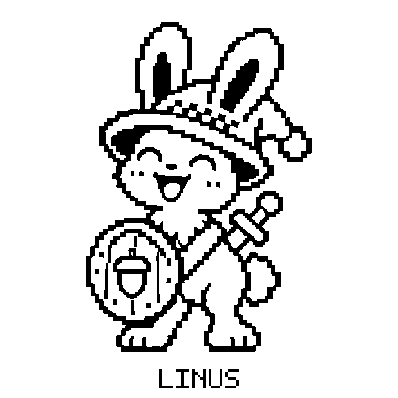

Anspielung: The Legend of Zelda. Ein kleiner Held: die langen Ohren schauen durch eine Zipfelmütze, dazu ein Holzschild und ein Holzschwert auf dem Rücken.
Wesen: mutig und abenteuerlustig – passt zu Ausflügen und zur kleinen Welt, die später kommen soll.

```
Use case: stylized-concept. Asset type: standalone character design drawing for a black-and-white virtual pet game. The attached image shows Evi, a pet from the same game: use it ONLY as reference for drawing style, line weight, dot pattern and overall size, NOT for species or features. Original character, not a copy of any existing game or franchise character. Strict pure black and white pixel art, crisp stepped pixel outlines, sparse regular black square dot dithering only on darker fur or skin areas, clean white face; no gray, no color, no gradients, no smooth vector lines, no 3D. White background, one large centered full-body character with generous white margins, no room, no UI, no watermark, no border, no props unless described. Expression: VERY HAPPY, matching the reference: joyful closed upward-curving crescent eyes, wide cute open smile, two tiny paired pixel cheek marks. One small discreet black pixel-font caption directly below the feet, no other text.
Character: LINUS, a small brave male rabbit adventurer. Long upright ears poke out through holes in a floppy pointed cap with a dotted pattern; the cap tip hangs down behind his head. He holds a small round wooden shield with a simple outlined emblem on one arm, and a tiny wooden toy sword handle shows over his shoulder. Fluffy white chest, dotted fur on ears and back, short round cottontail. Proud standing pose.
Caption verbatim: "LINUS".
```

### Bit – Roboterhund

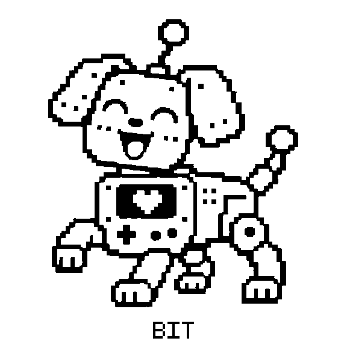

Anspielung: Game Boy und Mega Man. Sein Körper sieht aus wie eine kleine Spielkonsole, auf dem Bauch ein Bildschirm mit einem Pixelherz.
Wesen: neugierig und schlau – besonders gut bei „Melodie merken“.

```
Use case: stylized-concept. Asset type: standalone character design drawing for a black-and-white virtual pet game. The attached image shows Evi, a pet from the same game: use it ONLY as reference for drawing style, line weight, dot pattern and overall size, NOT for species or features. Original character, not a copy of any existing game or franchise character. Strict pure black and white pixel art, crisp stepped pixel outlines, sparse regular black square dot dithering only on darker fur or skin areas, clean white face; no gray, no color, no gradients, no smooth vector lines, no 3D. White background, one large centered full-body character with generous white margins, no room, no UI, no watermark, no border, no props unless described. Expression: VERY HAPPY, matching the reference: joyful closed upward-curving crescent eyes, wide cute open smile, two tiny paired pixel cheek marks. One small discreet black pixel-font caption directly below the feet, no other text.
Character: BIT, a small male robot puppy. His body is a rounded rectangle shaped like a retro handheld game console: a small screen on his chest shows a tiny pixel heart, with a little plus-shaped direction pad and two round buttons below it. Square head, floppy rectangular ears, a short antenna with a ball tip, stubby legs, a short wagging tail with two small motion lines. Panels mostly white with black outlines, a few dot-dithered panels for contrast.
Caption verbatim: "BIT".
```

### Blubber – kleiner Drache

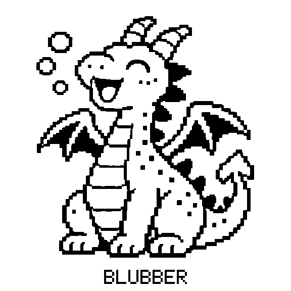

Anspielung: Bubble Bobble und Spyro. Kleine Flügel, Rückenzacken, und statt Feuer pustet er Seifenblasen.
Wesen: sanft und ein bisschen tollpatschig.

```
Use case: stylized-concept. Asset type: standalone character design drawing for a black-and-white virtual pet game. The attached image shows Evi, a pet from the same game: use it ONLY as reference for drawing style, line weight, dot pattern and overall size, NOT for species or features. Original character, not a copy of any existing game or franchise character. Strict pure black and white pixel art, crisp stepped pixel outlines, sparse regular black square dot dithering only on darker fur or skin areas, clean white face; no gray, no color, no gradients, no smooth vector lines, no 3D. White background, one large centered full-body character with generous white margins, no room, no UI, no watermark, no border, no props unless described. Expression: VERY HAPPY, matching the reference: joyful closed upward-curving crescent eyes, wide cute open smile, two tiny paired pixel cheek marks. One small discreet black pixel-font caption directly below the feet, no other text.
Character: BLUBBER, a small chubby male baby dragon. Round head with two short horns, small bat-like wings, a row of rounded back spikes, a curled tail with a spade tip on the viewer's right, white round belly with horizontal lines, dotted scales on head and back. Three round soap bubbles (outlined circles with a tiny white highlight) float up from his smiling mouth. Seated pose.
Caption verbatim: "BLUBBER".
```

### Groschen – Waschbär

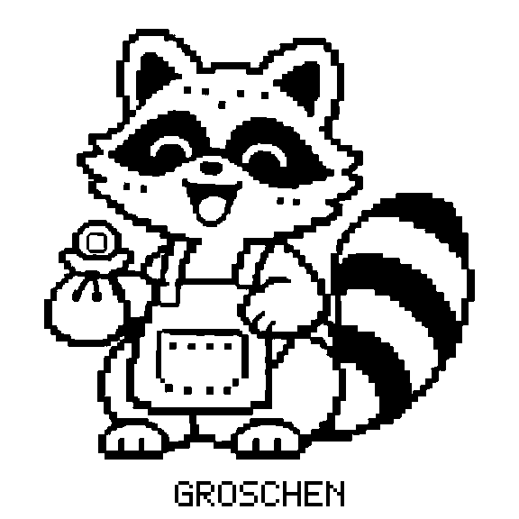

Anspielung: der Ladenbesitzer aus Animal Crossing. Augenmaske, geringelter Schwanz, Schürze und ein Münzbeutel.
Wesen: sparsam und geschäftstüchtig – könnte auch der Händler im geplanten Möbel-Laden sein.

```
Use case: stylized-concept. Asset type: standalone character design drawing for a black-and-white virtual pet game. The attached image shows Evi, a pet from the same game: use it ONLY as reference for drawing style, line weight, dot pattern and overall size, NOT for species or features. Original character, not a copy of any existing game or franchise character. Strict pure black and white pixel art, crisp stepped pixel outlines, sparse regular black square dot dithering only on darker fur or skin areas, clean white face; no gray, no color, no gradients, no smooth vector lines, no 3D. White background, one large centered full-body character with generous white margins, no room, no UI, no watermark, no border, no props unless described. Expression: VERY HAPPY, matching the reference: joyful closed upward-curving crescent eyes, wide cute open smile, two tiny paired pixel cheek marks. One small discreet black pixel-font caption directly below the feet, no other text.
Character: GROSCHEN, a small plump male raccoon shopkeeper. A solid black eye-mask band across his face with the happy crescent eyes drawn in white inside it, round ears, white muzzle and belly. A short bushy ringed tail on the viewer's right with alternating dotted and white rings. He wears a simple small apron with one pocket and holds a tiny coin pouch. Friendly seated pose.
Caption verbatim: "GROSCHEN".
```

### Leo – Löwenjunges

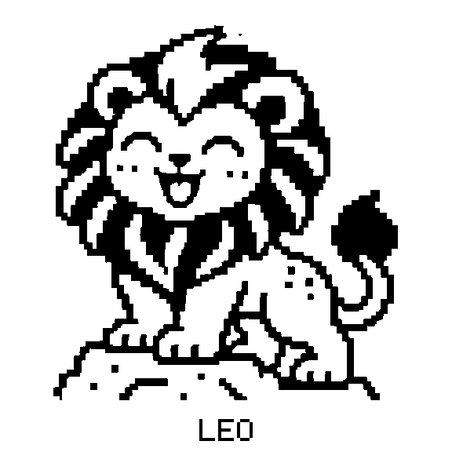

Anspielung: Simba aus „Der König der Löwen“. Ein Löwenjunges mit Haarbüschel auf dem Kopf, noch ohne Mähne, stolz auf einem kleinen Felsen.
Wesen: selbstbewusst und ein bisschen angeberisch – will immer im Mittelpunkt stehen.

```
Use case: stylized-concept. Asset type: standalone character design drawing for a black-and-white virtual pet game. The attached image shows Evi, a pet from the same game: use it ONLY as reference for drawing style, line weight, dot pattern and overall size, NOT for species or features. Original character, not a copy of any existing game or franchise character. Strict pure black and white pixel art, crisp stepped pixel outlines, sparse regular black square dot dithering only on darker fur or skin areas, clean white face; no gray, no color, no gradients, no smooth vector lines, no 3D. White background, one large centered full-body character with generous white margins, no room, no UI, no watermark, no border, no props unless described. Expression: VERY HAPPY, matching the reference: joyful closed upward-curving crescent eyes, wide cute open smile, two tiny paired pixel cheek marks. One small discreet black pixel-font caption directly below the feet, no other text.
Character: LEO, a small male lion cub. Round head with big rounded ears, a small tuft of hair sticking up on top of his head (no mane yet), white muzzle and chest, dotted fur on body, sturdy paws, a long thin tail ending in a dotted tuft on the viewer's right. Proud pose, chest out, sitting on top of a small pointed rock ledge.
Caption verbatim: "LEO".
```

### Blip – Außerirdischer

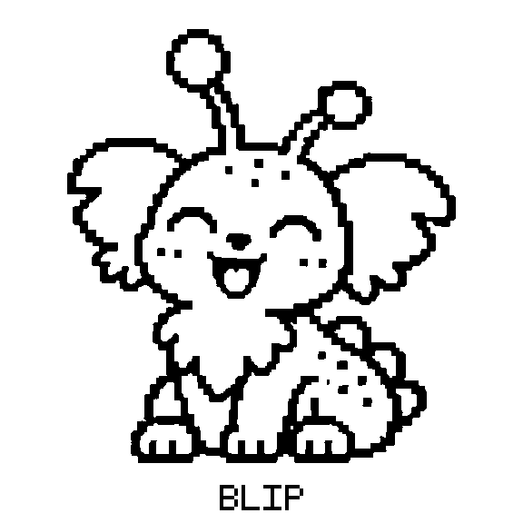

Anspielung: Stitch aus „Lilo & Stitch“. Riesige Ohren mit kleinen Kerben, große runde Nase, breites Grinsen, Fühler auf dem Kopf. Passt zum Familienthema: „Ohana heißt Familie“.
Wesen: frech und chaotisch – macht ab und zu Unordnung, hat aber ein großes Herz.

```
Use case: stylized-concept. Asset type: standalone character design drawing for a black-and-white virtual pet game. The attached image shows Evi, a pet from the same game: use it ONLY as reference for drawing style, line weight, dot pattern and overall size, NOT for species or features. Original character, not a copy of any existing game or franchise character. Strict pure black and white pixel art, crisp stepped pixel outlines, sparse regular black square dot dithering only on darker fur or skin areas, clean white face; no gray, no color, no gradients, no smooth vector lines, no 3D. White background, one large centered full-body character with generous white margins, no room, no UI, no watermark, no border, no props unless described. Expression: VERY HAPPY, matching the reference: joyful closed upward-curving crescent eyes, wide cute open smile, two tiny paired pixel cheek marks. One small discreet black pixel-font caption directly below the feet, no other text.
Character: BLIP, a small male alien creature, somewhere between a koala and a puppy. Very large ears sticking out sideways, each with a small notch in the edge, a big round nose, a very wide cheeky grin, two short antennae on his head, a small row of spikes on his back, short legs with tiny claws. Dotted fur on body and ears, white chest tuft and white inner ears. Mischievous seated pose, leaning slightly forward.
Caption verbatim: "BLIP".
```

---

## Weiblich

### Kiwi – Dino

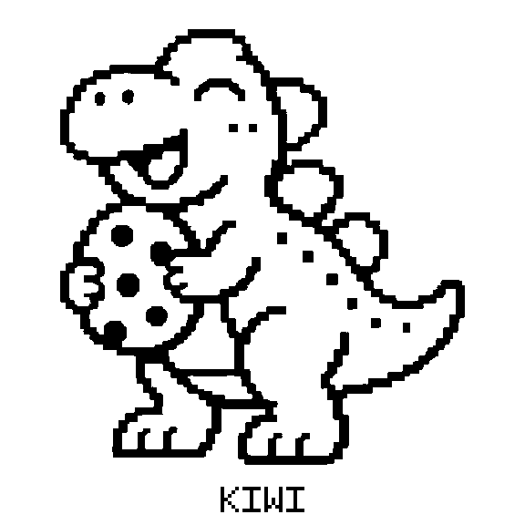

Anspielung: Yoshi. Runde große Schnauze, kleine Rückenplatten, und sie hält stolz ein geflecktes Ei – passend zum Thema Nachwuchs.
Wesen: fröhlich und verfressen.

```
Use case: stylized-concept. Asset type: standalone character design drawing for a black-and-white virtual pet game. The attached image shows Evi, a pet from the same game: use it ONLY as reference for drawing style, line weight, dot pattern and overall size, NOT for species or features. Original character, not a copy of any existing game or franchise character. Strict pure black and white pixel art, crisp stepped pixel outlines, sparse regular black square dot dithering only on darker fur or skin areas, clean white face; no gray, no color, no gradients, no smooth vector lines, no 3D. White background, one large centered full-body character with generous white margins, no room, no UI, no watermark, no border, no props unless described. Expression: VERY HAPPY, matching the reference: joyful closed upward-curving crescent eyes, wide cute open smile, two tiny paired pixel cheek marks. One small discreet black pixel-font caption directly below the feet, no other text.
Character: KIWI, a small female dinosaur. Big rounded snout, three small rounded plates along her back, short sturdy legs, a short thick tail on the viewer's right. White snout and belly, dotted skin on head, back and tail. She proudly hugs one small egg decorated with a few large black spots. Seated pose.
Caption verbatim: "KIWI".
```

### Mimi – Schnecke

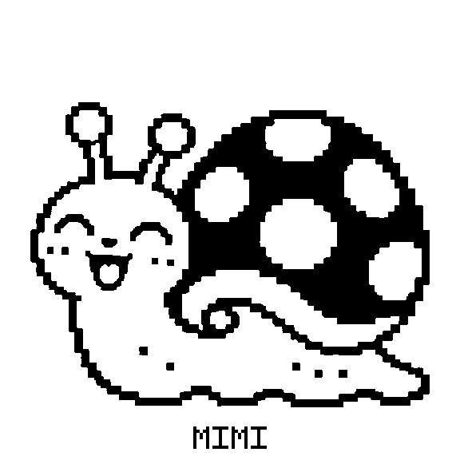

Anspielung: der gepunktete Pilz aus Super Mario. Ihr Schneckenhaus ist eine schwarze Pilzkappe mit großen weißen Punkten.
Wesen: gemütlich und ordentlich – langsam, aber immer sauber.

```
Use case: stylized-concept. Asset type: standalone character design drawing for a black-and-white virtual pet game. The attached image shows Evi, a pet from the same game: use it ONLY as reference for drawing style, line weight, dot pattern and overall size, NOT for species or features. Original character, not a copy of any existing game or franchise character. Strict pure black and white pixel art, crisp stepped pixel outlines, sparse regular black square dot dithering only on darker fur or skin areas, clean white face; no gray, no color, no gradients, no smooth vector lines, no 3D. White background, one large centered full-body character with generous white margins, no room, no UI, no watermark, no border, no props unless described. Expression: VERY HAPPY, matching the reference: joyful closed upward-curving crescent eyes, wide cute open smile, two tiny paired pixel cheek marks. One small discreet black pixel-font caption directly below the feet, no other text.
Character: MIMI, a small female snail. Soft round white body with a cute face and two short antennae with little ball tips. Her shell is a big round mushroom cap: a solid black dome covered with large round white spots. Her body stretches out a little toward the viewer's left. Cozy, relaxed pose.
Caption verbatim: "MIMI".
```

### Glöckchen – Hündin

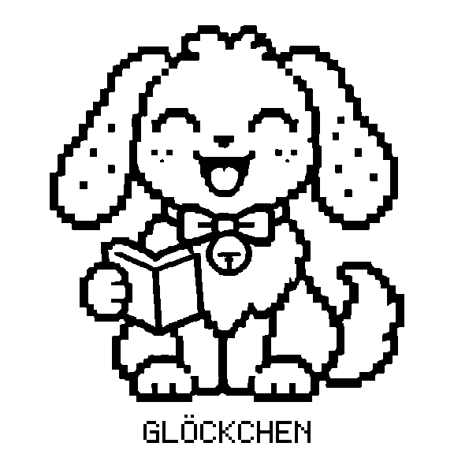

Anspielung: die hilfsbereite Sekretärin aus Animal Crossing. Schlappohren, ein Glöckchen an einer Schleife um den Hals, in der Pfote ein kleines Notizbuch.
Wesen: hilfsbereit – könnte später die Betreuung übernehmen, wenn du keine Zeit hast.

```
Use case: stylized-concept. Asset type: standalone character design drawing for a black-and-white virtual pet game. The attached image shows Evi, a pet from the same game: use it ONLY as reference for drawing style, line weight, dot pattern and overall size, NOT for species or features. Original character, not a copy of any existing game or franchise character. Strict pure black and white pixel art, crisp stepped pixel outlines, sparse regular black square dot dithering only on darker fur or skin areas, clean white face; no gray, no color, no gradients, no smooth vector lines, no 3D. White background, one large centered full-body character with generous white margins, no room, no UI, no watermark, no border, no props unless described. Expression: VERY HAPPY, matching the reference: joyful closed upward-curving crescent eyes, wide cute open smile, two tiny paired pixel cheek marks. One small discreet black pixel-font caption directly below the feet, no other text.
Character: GLÖCKCHEN, a small female puppy. Long floppy ears with dotted fur, a fluffy white chest, a small round bell on a ribbon bow around her neck, a short curled tail on the viewer's right. She holds a tiny notebook in one front paw. Neat, eager seated pose.
Caption verbatim: "GLÖCKCHEN".
```

### Lumi – Glühwürmchen-Fee

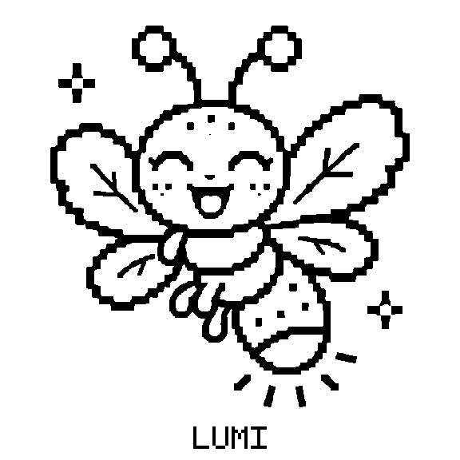

Anspielung: die Feen aus The Legend of Zelda („Hey, hör zu!“). Rundes Körperchen, große Flügel und ein leuchtendes Hinterteil.
Wesen: neugierig und redselig – meldet sich gern, wenn sie einen Wunsch hat.

```
Use case: stylized-concept. Asset type: standalone character design drawing for a black-and-white virtual pet game. The attached image shows Evi, a pet from the same game: use it ONLY as reference for drawing style, line weight, dot pattern and overall size, NOT for species or features. Original character, not a copy of any existing game or franchise character. Strict pure black and white pixel art, crisp stepped pixel outlines, sparse regular black square dot dithering only on darker fur or skin areas, clean white face; no gray, no color, no gradients, no smooth vector lines, no 3D. White background, one large centered full-body character with generous white margins, no room, no UI, no watermark, no border, no props unless described. Expression: VERY HAPPY, matching the reference: joyful closed upward-curving crescent eyes, wide cute open smile, two tiny paired pixel cheek marks. One small discreet black pixel-font caption directly below the feet, no other text.
Character: LUMI, a tiny round female firefly fairy. Round fluffy body, two small antennae with ball tips, two pairs of large wings drawn as white shapes with black outlines and a few thin vein lines. Her round tail light is a white circle with short radiating pixel rays. A few tiny four-point sparkles around her. Hovering pose with little legs tucked in.
Caption verbatim: "LUMI".
```

### Spuki – Geisterkätzchen

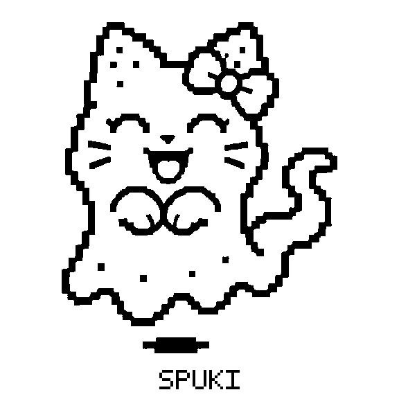

Anspielung: die Geister aus Pac-Man und Buu Huu aus Super Mario. Ein schwebender Geisterkörper mit Katzenohren und einer Schleife.
Wesen: schüchtern, aber treu – versteckt sich, wenn Besuch kommt.

```
Use case: stylized-concept. Asset type: standalone character design drawing for a black-and-white virtual pet game. The attached image shows Evi, a pet from the same game: use it ONLY as reference for drawing style, line weight, dot pattern and overall size, NOT for species or features. Original character, not a copy of any existing game or franchise character. Strict pure black and white pixel art, crisp stepped pixel outlines, sparse regular black square dot dithering only on darker fur or skin areas, clean white face; no gray, no color, no gradients, no smooth vector lines, no 3D. White background, one large centered full-body character with generous white margins, no room, no UI, no watermark, no border, no props unless described. Expression: VERY HAPPY, matching the reference: joyful closed upward-curving crescent eyes, wide cute open smile, two tiny paired pixel cheek marks. One small discreet black pixel-font caption directly below the feet, no other text.
Character: SPUKI, a small female ghost kitten. A floating ghost-shaped body with a rounded top and a wavy scalloped bottom hem instead of legs, two pointed cat ears, a cute bow on one ear, tiny paws in front, small whiskers, a little curled wisp like a tail. Mostly white body with a black stepped outline and a few dots on the ears. A small flat shadow ellipse below her.
Caption verbatim: "SPUKI".
```

### Moosi – Waldgeist

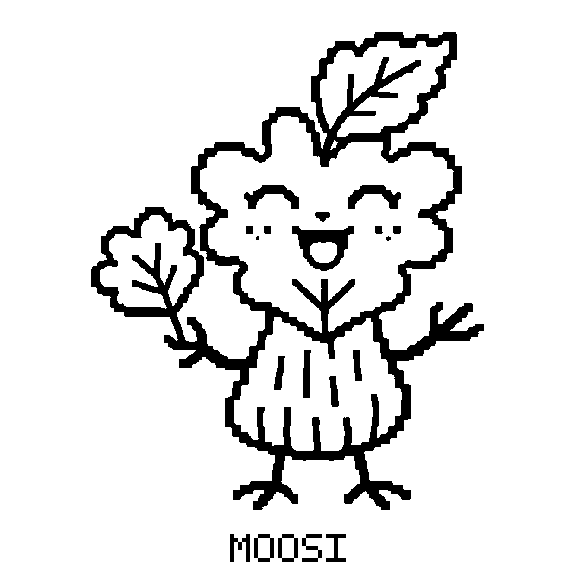

Anspielung: die kleinen Waldgeister (Krogs) aus „Zelda: Breath of the Wild“. Ein Körperchen aus Holz, dünne Zweigbeine, ein rundes Blattgesicht und ein großes Blatt auf dem Kopf.
Wesen: verspielt, versteckt sich gern – Idee für ein neues Minispiel „Wo ist Moosi?“: sie versteckt sich unter einem von drei Steinen.

```
Use case: stylized-concept. Asset type: standalone character design drawing for a black-and-white virtual pet game. The attached image shows Evi, a pet from the same game: use it ONLY as reference for drawing style, line weight, dot pattern and overall size, NOT for species or features. Original character, not a copy of any existing game or franchise character. Strict pure black and white pixel art, crisp stepped pixel outlines, sparse regular black square dot dithering only on darker fur or skin areas, clean white face; no gray, no color, no gradients, no smooth vector lines, no 3D. White background, one large centered full-body character with generous white margins, no room, no UI, no watermark, no border, no props unless described. Expression: VERY HAPPY, matching the reference: joyful closed upward-curving crescent eyes, wide cute open smile, two tiny paired pixel cheek marks. One small discreet black pixel-font caption directly below the feet, no other text.
Character: MOOSI, a tiny female forest spirit. A small round wooden body with thin twig arms and twig legs, her face is a flat round leaf-shaped mask with the happy eyes and smiling mouth on it, one big leaf sprouting from the top of her head like a little hat, a tiny twig tail. She holds a small leaf like a fan. Dotted wood texture on body and limbs, mask mostly white with a stepped outline and a central leaf vein.
Caption verbatim: "MOOSI".
```

### Mia – Kätzchen

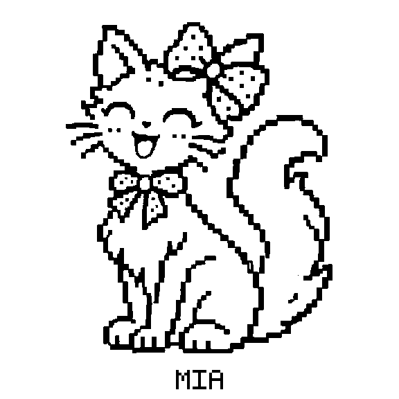

Anspielung: Marie aus „Aristocats“. Ein weißes, flauschiges Kätzchen mit großer Schleife auf dem Kopf, das sehr vornehm dasitzt.
Wesen: vornehm und eitel – Saubermachen macht sie besonders glücklich, Schmutz mag sie gar nicht.

```
Use case: stylized-concept. Asset type: standalone character design drawing for a black-and-white virtual pet game. The attached image shows Evi, a pet from the same game: use it ONLY as reference for drawing style, line weight, dot pattern and overall size, NOT for species or features. Original character, not a copy of any existing game or franchise character. Strict pure black and white pixel art, crisp stepped pixel outlines, sparse regular black square dot dithering only on darker fur or skin areas, clean white face; no gray, no color, no gradients, no smooth vector lines, no 3D. White background, one large centered full-body character with generous white margins, no room, no UI, no watermark, no border, no props unless described. Expression: VERY HAPPY, matching the reference: joyful closed upward-curving crescent eyes, wide cute open smile, two tiny paired pixel cheek marks. One small discreet black pixel-font caption directly below the feet, no other text.
Character: MIA, a small elegant female kitten with long fluffy pure white fur. A big neat bow on top of her head between her pointed ears, a smaller ribbon bow at her neck, long whiskers, a fluffy tail curling up on the viewer's right, only a few dots on the bow and ear tips. She sits very upright and proud with her chin slightly raised.
Caption verbatim: "MIA".
```

### Lotti – Rehkitz

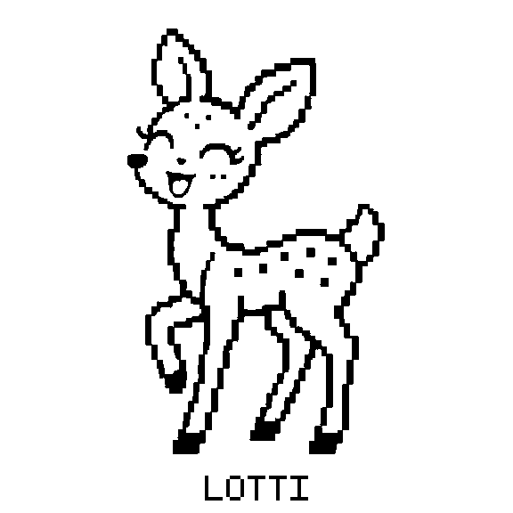

Anspielung: Bambi. Ein Rehkitz mit großen Augen, langen Wimpern, wackeligen dünnen Beinen und weißen Tupfen auf dem Rücken.
Wesen: verträumt und staunend – freut sich über jede Kleinigkeit.

```
Use case: stylized-concept. Asset type: standalone character design drawing for a black-and-white virtual pet game. The attached image shows Evi, a pet from the same game: use it ONLY as reference for drawing style, line weight, dot pattern and overall size, NOT for species or features. Original character, not a copy of any existing game or franchise character. Strict pure black and white pixel art, crisp stepped pixel outlines, sparse regular black square dot dithering only on darker fur or skin areas, clean white face; no gray, no color, no gradients, no smooth vector lines, no 3D. White background, one large centered full-body character with generous white margins, no room, no UI, no watermark, no border, no props unless described. Expression: VERY HAPPY, matching the reference: joyful closed upward-curving crescent eyes, wide cute open smile, two tiny paired pixel cheek marks. One small discreet black pixel-font caption directly below the feet, no other text.
Character: LOTTI, a small female fawn. Big head with large ears, long eyelashes, a small black nose, white muzzle and chest, slender long legs standing a little wobbly, a short white tail. Dotted body with several rows of clear white round spots along her back. Sweet, slightly shy standing pose.
Caption verbatim: "LOTTI".
```

### Klecksi – Dalmatinerwelpe

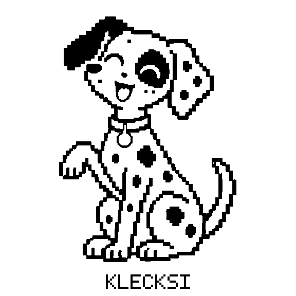

Anspielung: „101 Dalmatiner“. Ein weißer Welpe mit schwarzen Flecken, ein Ohr schwarz, ein Fleck ums Auge, Halsband mit Marke.
Wesen: wild und verspielt – wird schneller schmutzig, aber bei ihren Flecken sieht man es kaum.

```
Use case: stylized-concept. Asset type: standalone character design drawing for a black-and-white virtual pet game. The attached image shows Evi, a pet from the same game: use it ONLY as reference for drawing style, line weight, dot pattern and overall size, NOT for species or features. Original character, not a copy of any existing game or franchise character. Strict pure black and white pixel art, crisp stepped pixel outlines, sparse regular black square dot dithering only on darker fur or skin areas, clean white face; no gray, no color, no gradients, no smooth vector lines, no 3D. White background, one large centered full-body character with generous white margins, no room, no UI, no watermark, no border, no props unless described. Expression: VERY HAPPY, matching the reference: joyful closed upward-curving crescent eyes, wide cute open smile, two tiny paired pixel cheek marks. One small discreet black pixel-font caption directly below the feet, no other text.
Character: KLECKSI, a small female dalmatian puppy. Short white fur covered with irregular solid black round spots (instead of the dot pattern), one black floppy ear and one white floppy ear, a black spot around one eye, a small collar with a round tag, a thin tail on the viewer's right. Playful seated pose with one front paw raised.
Caption verbatim: "KLECKSI".
```

### Ella – Elefantenbaby

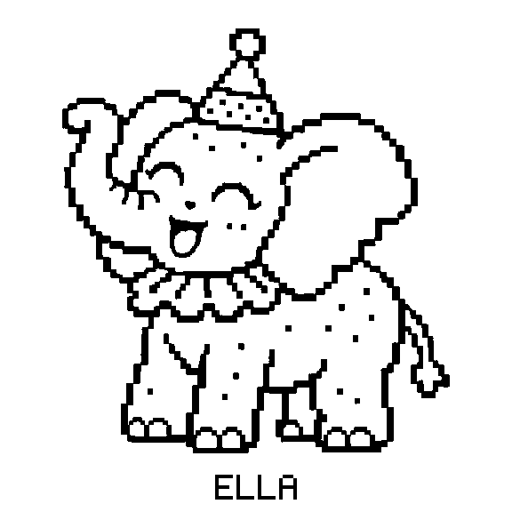

Anspielung: Dumbo. Ein Elefantenbaby mit riesigen Ohren, mit denen es fast fliegen könnte, und einem kleinen Zirkushütchen.
Wesen: lieb und etwas unsicher – Lob, Spielen und erfüllte Wünsche machen sie besonders schnell glücklich.

```
Use case: stylized-concept. Asset type: standalone character design drawing for a black-and-white virtual pet game. The attached image shows Evi, a pet from the same game: use it ONLY as reference for drawing style, line weight, dot pattern and overall size, NOT for species or features. Original character, not a copy of any existing game or franchise character. Strict pure black and white pixel art, crisp stepped pixel outlines, sparse regular black square dot dithering only on darker fur or skin areas, clean white face; no gray, no color, no gradients, no smooth vector lines, no 3D. White background, one large centered full-body character with generous white margins, no room, no UI, no watermark, no border, no props unless described. Expression: VERY HAPPY, matching the reference: joyful closed upward-curving crescent eyes, wide cute open smile, two tiny paired pixel cheek marks. One small discreet black pixel-font caption directly below the feet, no other text.
Character: ELLA, a small female baby elephant. Enormous floppy ears much bigger than her head, spread out a little as if she could fly with them, white inner ears. A short trunk curled up happily, a tiny round pointed circus hat on top of her head, a little ruffled collar, short stubby legs, a thin tail with a small tuft. Sparse dot texture on body and outer ears. Cheerful seated pose.
Caption verbatim: "ELLA".
```
