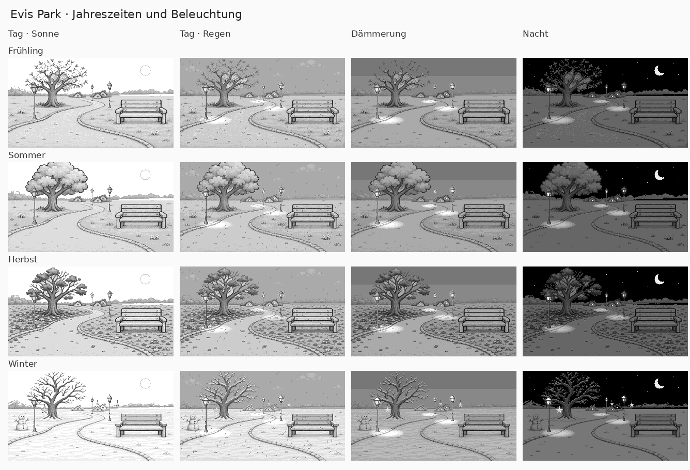
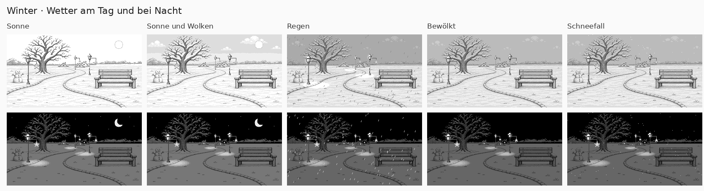

# Park mit Nachbarschaft am Horizont

Stand: 26. November 2026. Die Nutzerin hat die korrigierte Parkansicht einschließlich überarbeiteter Laternen für alle Jahreszeiten, Tageszeiten und Wetterlagen bestätigt und das Hochladen auf GitHub ausdrücklich freigegeben.



## Gestaltung und Beleuchtung

- Genau drei kleine Häuser am hinteren Kiesweg: eines links, zwei rechts, leicht hintereinander. Alle stehen auf dem Boden. Bäume und Sträucher am Horizont bleiben erhalten. Die zwei dünnen Bäumchen mit einzelnen Blättern wurden entfernt.
- Alle drei Hausfenster leuchten **nachts, bei Dämmerung und bei Regen**, also auch bei Regen am Tag. Bewölkung allein schaltet sie tagsüber nicht ein.
- Drei separate Laternen stehen entlang des Wegs, als freigestellte Graustufenzeichnungen passend zur Bank. Ihre Höhe nimmt mit der Tiefe von 72 über 52 auf 34 Pixel ab. Die Laternen nutzen dieselbe Einschaltregel und zeigen deutlich hellere, breite Lichtflächen auf dem Kiesweg sowie einen kleinen Schein um das Glas. Die Wegtextur bleibt sichtbar.
- Klar erkennbare fünfzackige Sterne mit eigener Graustufenzeichnung hängen an Auslegern der Laternen, vom 18. November bis einschließlich 5. Januar. Diese Zeitspanne übernimmt die bereits vorhandene Spielregel. Die Glasbeleuchtung, Schneedecke auf dem Dach und saisonale Sternzeichnung sind voneinander unabhängig.
- Frühling: Blüten; Sommer: volle Baumkrone; Herbst: weniger Laub am Baum, deutlich mehr Laub am Boden, besonders um den Baumfuß, und Pilze anstelle der Blumen. Winter: Schnee auf Ästen, am Baumfuß, auf Sträuchern, Bank, Haus- und Laternendächern; deutlich größerer Schneemann und kleine kahle Sträucher um die Häuser. Keine Fußspuren.
- Sonniger Himmel fast weiß, bedeckter und regnerischer Himmel dunkler. Nachts bleibt der freie Himmel vollständig schwarz. Mond und Sterne erscheinen nachts bei klarem Himmel. Schneefall ist nur im Winter vorgesehen; Winterregen und Wintersonne bleiben möglich.



## Dateien und Nachbau

`quellen/` enthält die vier hochauflösenden Ausgangsentwürfe sowie die freigestellten Zeichnungen von Laterne und Stern. `park-*.png` sind daraus ausschließlich für das Displayformat skalierte und auf 16 Graustufen gebrachte Grundbilder (320 × 174 Pixel). `laterne.png` und `stern.png` sind die vorbereiteten transparenten Einzelgrafiken. Beleuchtung, Laternen, Weihnachtsschmuck und Niederschlag werden getrennt von der Firmware gezeichnet.

`ansichten/` enthält die **51 zulässigen Kombinationen** als PNGs in tatsächlicher Displaygröße: vier Jahreszeiten × drei Tageszeiten × vier Wetterzustände sowie drei zusätzliche Winteransichten mit Schneefall. Diese Bilder und die Übersichten stammen direkt aus dem Firmware-Zeichencode, nicht aus einer zweiten Nachzeichnung.

```sh
python3 software/schritt-10/tools/prepare-park-v2.py
python3 software/schritt-10/tools/make-park-grau.py
bash software/schritt-10/tools/pc-nachbildung/pruefen.sh /tmp/evi-park --zimmer
python3 software/schritt-10/tools/make-park-ansichten.py /tmp/evi-park/bilder
```

Die Grundbilder liefern die Jahreszeit. Himmelsmasken, Fensterlicht, Laternenlicht und animierter Niederschlag sind getrennte Darstellungen. Die Himmelssuche startet nicht in der oben angeschnittenen Sommerkrone und schützt Schneekanten unmittelbar über dunklen Winterästen.

## Spielumfang und Prüfung

Die Häuser sind Kulisse. Sie haben keine neue Tippfläche, keinen Hausbesitzer und kein Besuchsmenü. Der spätere Ablauf „Evi geht den Kiesweg entlang → Besuch auswählen → Freund auswählen“ ist in `PROJEKTSTAND.md` vorgemerkt und wird hier nicht umgesetzt.

Die PC-Nachbildung prüft alle 51 Kombinationen, Fensterlicht, schwarzen Nachthimmel, 16 Graustufen, Szenengrenzen und Antippen der Häuser. Die vorhandenen Prüfungen für Parkwege, Fundstücke, Speicherung, Heimkehr, Zimmer und Einrichtung bleiben Bestandteil des gezielten Prüflaufs. Eine Prüfung am physischen Waveshare-Board steht noch aus.
