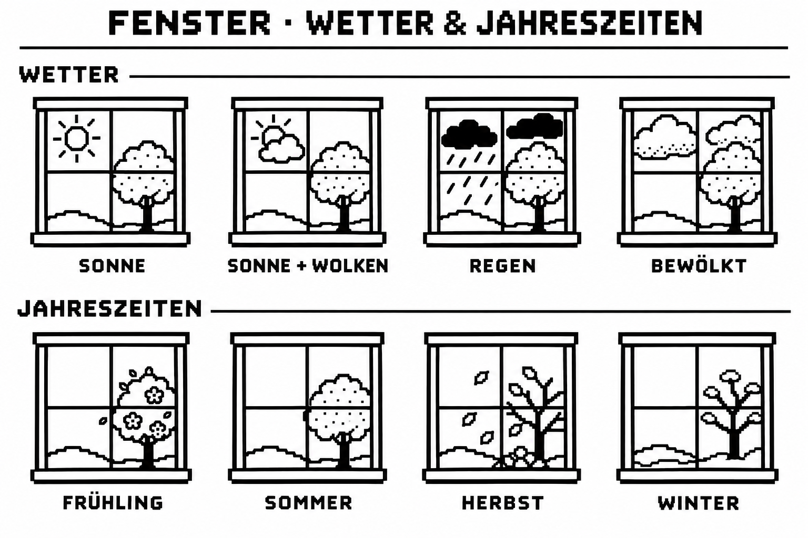

# Evis Umgebung – Gestaltungsvorschläge

Stand: 24. November 2026. Beschlossene Linie: **Gemütlich & schlicht (Variante A)**.

## Möbel und Boden

Tisch, Topfpflanze, Napf mit Pfotenmotiv, Bücherregal, Sideboard und Holzdielen sind auf der Vorschautafel einzeln dargestellt. Diese Datei ist eine beschriftete Konzeptübersicht, noch kein Satz freigestellter Spielgrafiken. Variante B wurde nicht ausgewählt.

## Bestätigte Jahreszeiten

Draußen vor dem Fenster steht ein kleiner Laubbaum: Blüten im Frühling, volle Krone im Sommer, fallende Blätter im Herbst, kahle Äste im Winter. Die Formen bleiben in Schwarz-Weiß erkennbar.

## Fünf Wetterzustände, frei mit vier Jahreszeiten kombiniert

Sonne, Sonne mit Wolken, Regen, bewölkt und Schneefall sind unabhängig von der Jahreszeit. Winter mit Sonne oder Regen ist ausdrücklich möglich; Schneefall kann mit jeder Jahreszeit kombiniert werden. Liegender Schnee und fallende Flocken sind getrennte Darstellungen. Das Wetter wird ohne Internet simuliert; Auswahl und Häufigkeit bleiben offen. Nachthimmel mit Mond, Sternen und Sternschnuppen bleibt bestehen.

## Weihnachtsbaum

Jedes Jahr vom **18. November bis einschließlich 5. Januar** ersetzt der Weihnachtsbaum das **Wandregal und die Topfpflanze**. Am **6. Januar** kehren Regal und Pflanze zurück. Maßgeblich ist die deutsche Ortszeit. Eine Änderung des Tischs wurde nicht beschlossen.

Der Baum ist ein separater PNG-Entwurf mit transparentem Hintergrund. Er verwendet die gewählte Gestaltungslinie mit Stern, wenigen Kugeln und einer Girlande.

## Status

Originale Bildvorschläge aus der gemeinsamen Gestaltung. Die PNG-Dateien werden unverändert aufbewahrt. **Noch keine Integration in Handy-App oder Waveshare-Software und keine Änderung der laufenden Spielversion.** Für die spätere Integration müssen Konzeptübersichten in einzelne Grafiken aufbereitet und die Datumsregel umgesetzt werden.
