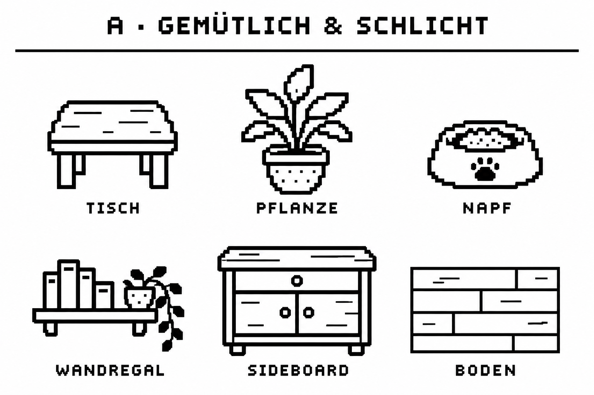
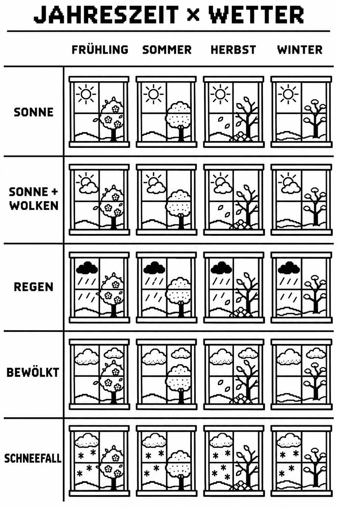

# Evis Umgebung – Gestaltungsvorschläge

Stand: 24. November 2026. Beschlossene Linie: **Gemütlich & schlicht (Variante A)**.

## Möbel und Boden

Tisch, Topfpflanze, Napf mit Pfotenmotiv, Bücherregal, Sideboard und Holzdielen sind auf der Vorschautafel einzeln dargestellt. Diese Datei ist eine beschriftete Konzeptübersicht, noch kein Satz freigestellter Spielgrafiken. Variante B wurde nicht ausgewählt.

## Bestätigte Jahreszeiten

Draußen vor dem Fenster steht ein kleiner Laubbaum: Blüten im Frühling, volle Krone im Sommer, fallende Blätter im Herbst, kahle Äste im Winter. Die Formen bleiben in Schwarz-Weiß erkennbar.

## Fünf Wetterzustände, frei mit vier Jahreszeiten kombiniert

Sonne, Sonne mit Wolken, Regen, bewölkt und Schneefall sind unabhängig von der Jahreszeit. Winter mit Sonne oder Regen ist ausdrücklich möglich; Schneefall kann mit jeder Jahreszeit kombiniert werden. Liegender Schnee und fallende Flocken sind getrennte Darstellungen. Das Wetter wird ohne Internet simuliert; Auswahl und Häufigkeit bleiben offen. Nachthimmel mit Mond, Sternen und Sternschnuppen bleibt bestehen.

## Weihnachtsbaum

Jedes Jahr vom **18. November bis einschließlich 5. Januar** ersetzt der Weihnachtsbaum das **Wandregal und die Topfpflanze**. Am **6. Januar** kehren Regal und Pflanze zurück. Maßgeblich ist die deutsche Ortszeit. Eine Änderung des Tischs wurde nicht beschlossen.

Der Baum ist ein separater PNG-Entwurf mit transparentem Hintergrund. Er verwendet die gewählte Gestaltungslinie mit Stern, wenigen Kugeln und einer Girlande.

## Weitere Weihnachtsdekoration – Auswahl vom 24. November 2026

- **Fenster mit Sternen** ist ausgewählt: kleine hängende Sterne und eine schlichte Sternengirlande am äußeren Fensterrahmen. Der Blick auf Jahreszeitenbaum und Wetter bleibt frei.
- **Kerzentablett auf dem Sideboard** ist ausgewählt: drei unterschiedlich hohe Kerzen auf einem kleinen Tablett, ergänzt durch einen kurzen Tannenzweig und wenige Beeren.
- Beide Elemente folgen der Gestaltungslinie „Gemütlich & schlicht“ und sind mit dem Weihnachtsbaum kombinierbar.
- Fenster mit Tannengrün und Adventskranz wurden nicht ausgewählt. Flackernde Flammen waren nur ein Vorschlag und sind noch nicht beschlossen.
- Der Sichtbarkeitszeitraum dieser zusätzlichen Dekoration ist noch nicht ausdrücklich festgelegt; die bestehende Datumsregel gilt bisher für den Weihnachtsbaum.
- Auswahl und Gestaltung sind festgehalten; die Dekoration ist noch nicht in das Spiel integriert.

## Freigestellte Weihnachtsdekoration

Die ausgewählten Dekorationen liegen als separate PNGs mit transparentem Hintergrund vor:

| Datei | Größe | Inhalt |
| --- | --- | --- |
| [`fenster-sterne.png`](fenster-sterne.png) | 2172 × 724 Pixel | Sternengirlande mit hängenden Sternen, ohne Fensterrahmen und ohne Landschaft. Als Dekoration über dem vorhandenen Fenster vorgesehen. |
| [`kerzentablett.png`](kerzentablett.png) | 1536 × 1024 Pixel | Drei unterschiedlich hohe Kerzen mit Flammen, Tannenzweig und Beeren auf einem Tablett; ohne Sideboard. |

Freistellungen aus den ausgewählten Bildvorschlägen, mit der integrierten Bildbearbeitung erstellt. Transparenter Außenbereich und weiße Innenflächen der Dekoration bleiben erhalten. Die ursprünglichen Auflösungen sind hier unverändert aufbewahrt; die spätere Anpassung an das kleine Display erfolgt bei der Einbindung. Seit 24. November 2026 auf dem Waveshare eingebaut (statt der Platzhalter), mit `software/schritt-10/tools/make-umgebung.py`.

## Status

Originale Bildvorschläge aus der gemeinsamen Gestaltung. Die PNG-Dateien werden unverändert aufbewahrt. **Seit 24. November 2026 auf dem Waveshare eingebaut** (nicht in der Handy-App): Möbel, Jahreszeiten, Wetter und Weihnachtsdeko, aufbereitet mit `software/schritt-10/tools/make-umgebung.py`; Einzelheiten in `software/schritt-10/README.md`. Sterne am Fenster und Kerzentablett gelten im selben Zeitraum wie der Baum.
