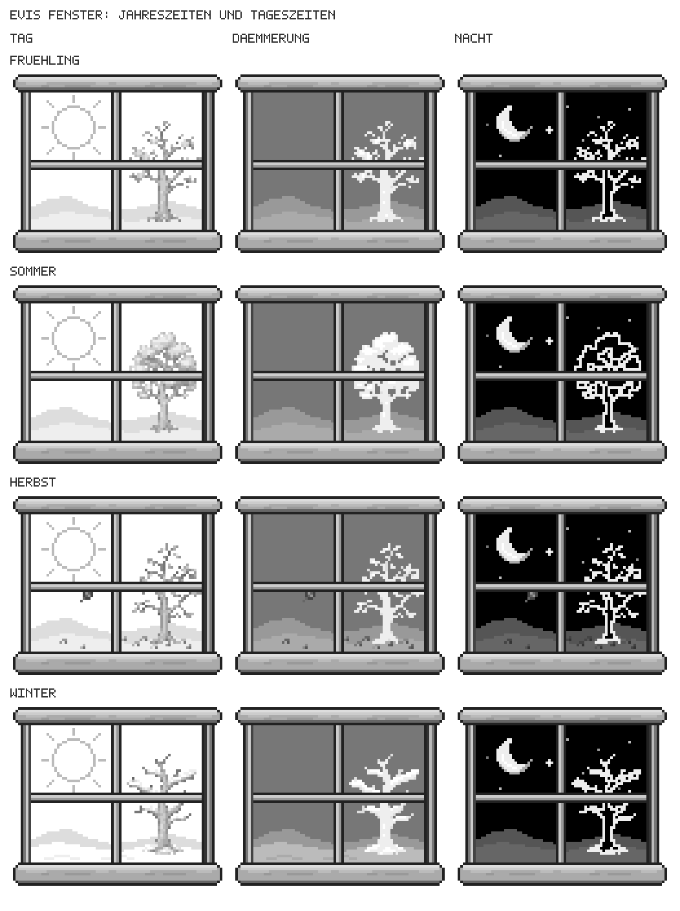
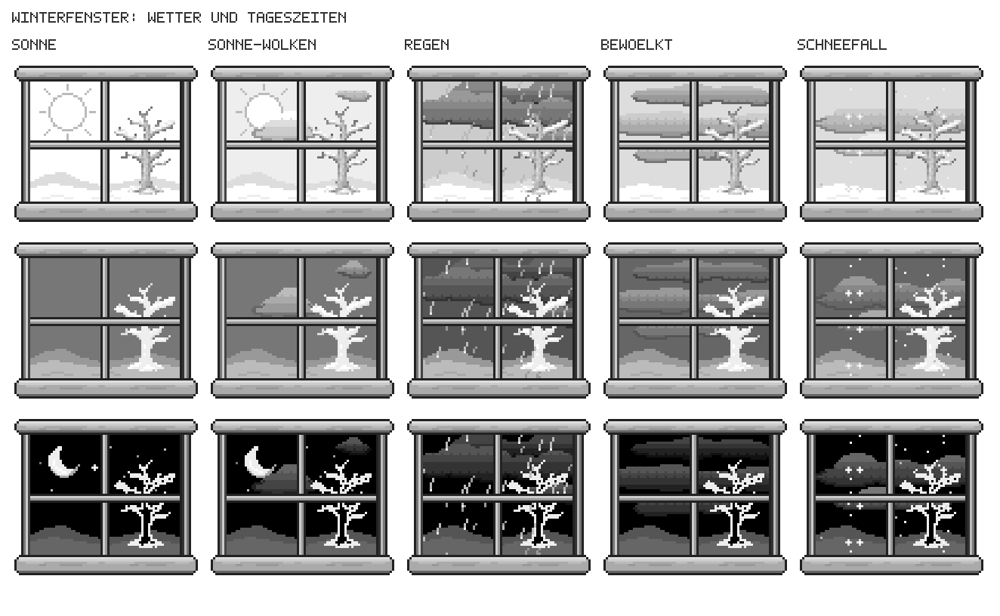

# Heller Fensterausblick für Evis Waveshare

Stand: 26. November 2026. Von der Nutzerin nach der Tageslicht-Vorschau zum Umsetzen und Hochladen freigegeben.

## Darstellung

- Sonne: fast weißer Himmel, heller Boden und hellere Bäume in allen vier Jahreszeiten. Die Sonne besitzt eine feine graue Kontur.
- Wolken und Regen: abgestufte, insgesamt freundlichere Helligkeiten; Regen ist dunkler als Sonne.
- Dämmerung: eigener grauer Himmel, heller Baum, kein Mond.
- Nacht: schwarzer freier Himmel, schwarzer Baum mit hellem Rand; Mond und Sterne bei klarem Himmel. Landschaft und Schneeboden werden zur Nacht dunkler.
- Winter: Schnee auf Ästen und am Baumfuß auch bei Sonnenschein, unabhängig von fallendem Schnee. Schneefall nur im Winter.
- Bestehende Regen-, Schnee- und Herbstblattanimationen sowie Fensterrahmen und Scheibengrenzen bleiben erhalten.

## Paket und Code

`ebenen/` enthält sämtliche 91 benötigten Fensterebenen in 66 × 53 Pixeln (Herbstblatt: 5 × 6), mit 16 Graustufen und binärer Transparenz. Die 16 Regen- und 16 Schneefallphasen sind enthalten. `quellen/` enthält die vier standardisierten Baumzeichnungen. `fensterrahmen.png` ist der passende vorhandene Rahmen. `ansichten/` zeigt alle 51 erlaubten Kombinationen als 83 × 71 große Fensteransichten einschließlich Rahmen und Prüfrand.

Die Grafiken sind in `software/schritt-10/evi-handy/zimmergrau.h` gepackt und in `einrichtung.ino` angebunden. Für das Gerät den aktuellen gesamten Ordner `software/schritt-10/evi-handy` holen, `evi-handy.ino` in der Arduino IDE öffnen und wie gewohnt übertragen. Die PNGs müssen nicht separat auf das Board kopiert werden.

Der Grafikexport `tools/make-zimmer-grau.py` liest die neuen Fensterebenen und verwendet für übrige Zimmergrafiken weiterhin die bisherigen Quellen. Zum Regenerieren und Prüfen:

```sh
python3 software/schritt-10/tools/make-zimmer-grau.py
bash software/schritt-10/tools/pc-nachbildung/pruefen.sh /tmp/evi-fenster --zimmer
```

## Prüfstand und Wiederherstellung

Vor der Unterbrechung der Arbeitsumgebung bestanden die native PC-Übersetzung, die bisherigen Zimmer-/Parkprüfungen sowie der Vergleich von 51 Fensterkombinationen mit insgesamt 411 Animationsansichten. Nach dem Ausfall wurden die Daten aus den noch verfügbaren Originalgrafiken und dem Repository wiederhergestellt. Die mittleren Helligkeiten der vier standardisierten Baumzeichnungen stimmen mit dem zuvor geprüften Stand überein. Alle 98 gepackten Zimmergrafiken wurden wieder aus dem Header gelesen; die 51 Kombinationen und 411 Animationsansichten stimmen zwischen den PNG-Ebenen und den gepackten Daten überein und verwenden ausschließlich 16 Graustufen. Eine erneute native C++-Übersetzung nach der Wiederherstellung war ohne Arbeitsumgebung nicht möglich. Ein Test auf dem physischen Waveshare-Board steht aus.




