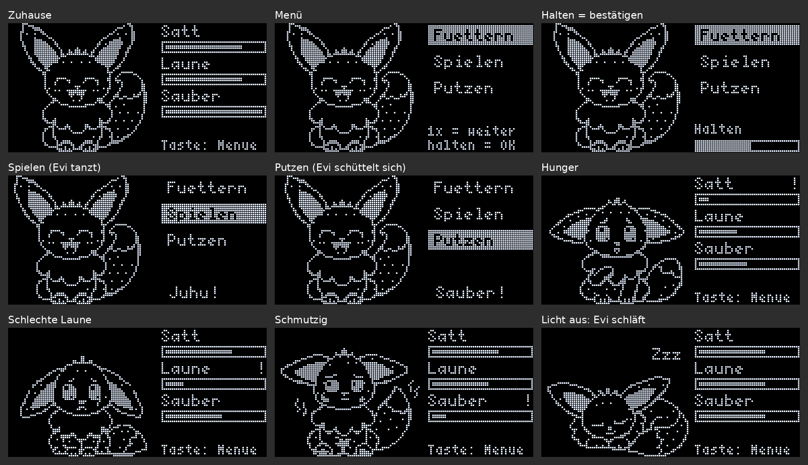

# Schritt 7: Evis Zeichnungen, drei Bedürfnisse und Spielstand

Die Vorschau stammt aus einer Nachbildung des Displays am PC. Sie zeigt genau die Punkte, die der Nano zeichnet; die Schrift ist dieselbe Schriftfamilie wie in U8g2.

## Aufspielen

In der Arduino IDE `software/schritt-07/evi-cube/evi-cube.ino` öffnen und mit dem Pfeil hochladen. Board und Port bleiben wie bisher.

Beim ersten Start beginnt eine neue Evi. Ab dann merkt sie sich ihren Stand.

## Was neu ist

**Deine Zeichnungen:** Links auf dem Display ist jetzt die erwachsene Evi aus deinen Zeichnungen zu sehen, ohne Zimmer: glücklich, hungrig, traurig, schmutzig und schlafend. Die Bilder sind nur gleichmäßig verkleinert und in an/aus umgerechnet; die Linien der Zeichnung leuchten. Erzeugt werden sie mit `tools/make-art.py` aus `handy-app/dist/img/adult-*.png`.

**Drei Bedürfnisse** wie bei der erwachsenen Evi in der Handy-App:

| | Satt | Laune | Sauber |
| --- | --- | --- | --- |
| Start | 80 | 80 | 100 |
| Pro Stunde wach | −20 | −15 | −12 |
| Im Schlaf (Licht aus) | 15 % davon | 10 % davon | 15 % davon |
| Füttern | +40 | +3 | −2 |
| Spielen | −8 | +30 | −5 |
| Putzen | – | +3 | +60 |

- Rechts stehen die drei Werte als Balken. Ein „!“ zeigt an, dass ein Wert bei 30 oder darunter ist.
- Das Bild richtet sich nach dem niedrigsten Wert, sobald er 30 oder weniger ist: hungrig, traurig oder schmutzig. Sonst ist Evi glücklich.
- Beim Spielen tanzt Evi hin und her, beim Putzen schüttelt sie sich. Jede Pflege hat eine eigene kleine Melodie.
- Sinkt ein Wert auf 30, piept Evi einmal. Im Dunkeln wartet sie damit bis zum Aufwachen.
- LEDs: grün = alles über 50, gelb = ein Wert zwischen 31 und 50, rot blinkend = ein Wert bei 30 oder darunter.

**Menü:** Taste kurz drücken öffnet das Menü mit Füttern, Spielen und Putzen. Kurz drücken = weiter, halten = ausführen, zweimal kurz = zurück.

**Spielstand:** Evi speichert ihre drei Werte im EEPROM des Nano: alle 10 Minuten, nach jeder Pflege und beim Einschlafen und Aufwachen. Nach dem Ausstecken macht sie dort weiter. Die Zeit ohne Strom zählt als Pause, weil der Cube keine Uhr mit Batterie hat.

**Neue Evi:** Den Taster gedrückt halten, während du das USB-Kabel einsteckst. Dann ertönt eine andere Melodie und Evi beginnt wieder bei 80/80/100.

## Technik

- `pet.h`: Spielregeln mit drei Werten, Bildauswahl und Reaktionen. Keine Abhängigkeit von Arduino.
- `menu.h`: drei Aktionen statt Winken und Füttern.
- `save.h`: Spielstand reihum in 16 Plätzen zu 8 Bytes (Adressen 0–127). Jede EEPROM-Zelle hält etwa 100.000 Schreibvorgänge; durch das Reihum-Schreiben reicht das bei etwa 170 Speicherungen am Tag für Jahrzehnte. Eine Prüfsumme erkennt halb geschriebene Plätze nach einem Stromausfall; dann gilt der vorige Stand.
- `evi_art.h`: die fünf Bilder, zusammen 2.235 Bytes im Flash-Speicher. Nicht von Hand ändern, sondern mit `tools/make-art.py` neu erzeugen (Python 3 mit Pillow).
- `melody.h`: neue Melodien für Spielen, Putzen und neue Evi.
- Unverändert aus Schritt 6: `button_input.h`, `commands.h`, Pinbelegung, Licht und Ton.
- Der Prüflauf mit `#define RUN_CHECKS` ist mit 54 Prüfungen größer geworden und passt zusammen mit U8g2 womöglich nicht mehr in den Nano. Die Prüfungen laufen auch am PC.

## Geprüft (20. November 2026)

- Für den Nano übersetzt (ohne echte U8g2, wie in Schritt 5): 11,9 KB Programmspeicher, 645 Byte Arbeitsspeicher. Mit U8g2 werden es schätzungsweise 22–26 KB von 30 KB.
- 54 Prüfungen aus `checks.h` am PC bestanden: Tempo der drei Werte wach und im Schlaf, Füttern, Spielen, Putzen, Bildauswahl, Überlauf der Uhr, Speichern und Laden, 300 Speicherungen reihum, beschädigter Platz, neue Evi.
- 21 Prüfungen in einer Nachbildung des ganzen Sketches bestanden, mit den Vorschaubildern oben: Menü, Halten, alle drei Pflegen mit Melodie, Hinweiston nach Stunden, rote LED, Speichern alle 10 Minuten, Schlafen, Spielstand nach Neustart und neue Evi per Taster.
- **Noch nicht auf dem echten Cube getestet.**
